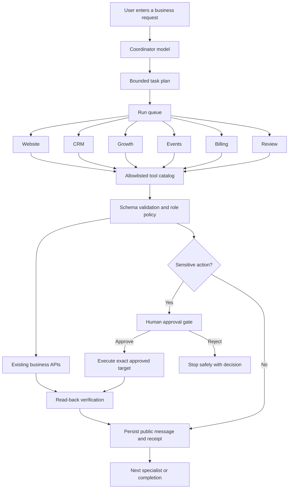
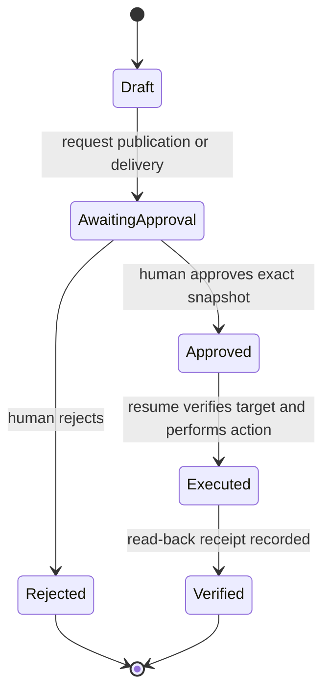
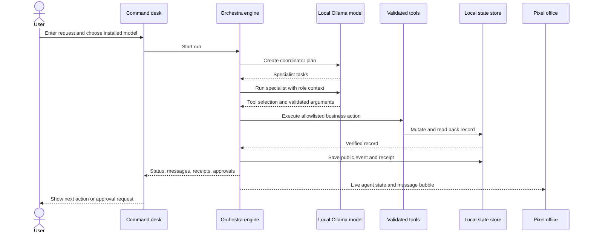
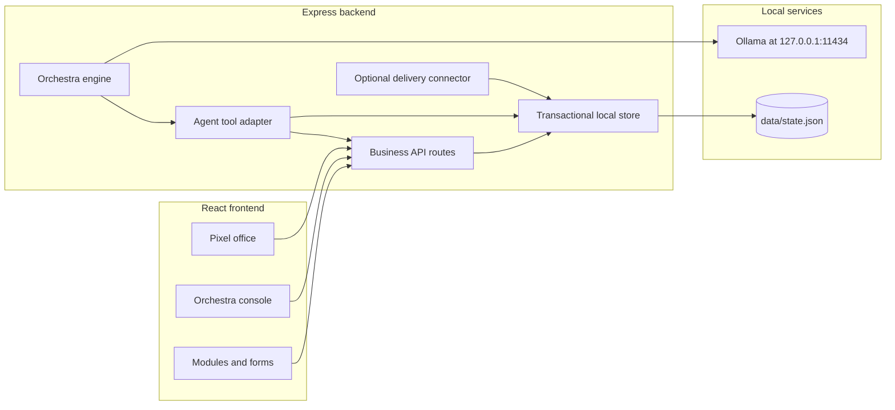
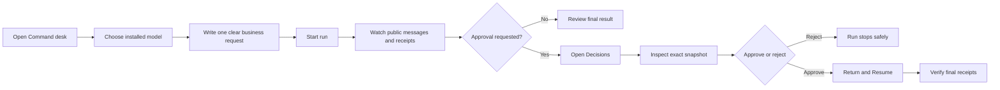

# Nexus World

### A local-first AI business orchestra with a living pixel-art office

[](https://react.dev/)
[](https://www.typescriptlang.org/)
[](https://vite.dev/)
[](https://expressjs.com/)
[](https://ollama.com/)
[](#license)

Nexus World is an experimental, local-first business operations workspace. A user gives the system one business request, a local Ollama model coordinates specialist agents, and those agents perform validated business actions through a controlled tool layer. The result is shown in a detailed pixel-art office, a command console, and persisted execution receipts.

The project combines:

- **Actual model-driven orchestration** rather than a scripted transcript.
- **Role-restricted specialist agents** for Website, CRM, Growth, Events, Billing, and Review.
- **Validated business tools** that reuse the same APIs as the user interface.
- **Human approval gates** before sensitive actions such as publication and email delivery.
- **Read-back verification and receipts** so model prose cannot stand in for a successful write.
- **Local JSON persistence** for a simple, inspectable prototype.

> **Project status:** Nexus World is a local prototype and development project. It is not a production SaaS, a secure multi-tenant platform, or a replacement for a full CRM, marketing automation, payment, or video-conferencing product.

## Contents

- [Why Nexus World](#why-nexus-world)
- [How it works](#how-it-works)
- [Feature overview](#feature-overview)
- [Architecture](#architecture)
- [Requirements](#requirements)
- [Quick start](#quick-start)
- [Configure optional email delivery](#configure-optional-email-delivery)
- [Use the application](#use-the-application)
- [Available scripts](#available-scripts)
- [API surface](#api-surface)
- [Data and persistence](#data-and-persistence)
- [Security and safety boundaries](#security-and-safety-boundaries)
- [Testing and verification](#testing-and-verification)
- [Project structure](#project-structure)
- [Troubleshooting](#troubleshooting)
- [Roadmap](#roadmap)
- [Contributing](#contributing)
- [License](#license)

## Why Nexus World

Most AI business demos stop at generated text. Nexus World explores a stricter model:

1. A coordinator turns a natural-language request into bounded specialist tasks.
2. Each specialist receives a specific identity, task, context, and allowlisted tools.
3. Tool arguments are validated before any business mutation is attempted.
4. Successful mutations are read back and recorded as receipts.
5. Sensitive actions pause for an exact human decision.
6. Resuming a run verifies the original approval instead of replaying earlier writes.

This makes the application useful as a learning project for agent orchestration, local AI, human-in-the-loop workflows, and auditable business actions.

## How it works

### End-to-end orchestration



### Approval lifecycle



### What the user sees



## Feature overview

| Area | What works today | Important boundary |
| --- | --- | --- |
| **Pixel office** | Original pixel-art rooms, characters, role status, live messages, handoffs, and activity state | Animation is decorative; persisted runs drive meaningful status |
| **Command desk** | Model selection, prompts, run history, public agent messages, tool receipts, approvals, resume, and cancel | Requires a locally installed model for live orchestration |
| **Website** | Create/edit blocks, preview pages, request publication, publish after approval, public registration URL | Small block editor, not a full Webflow-style builder |
| **CRM** | Create, search, filter, stage, consent, and normalized-email deduplication | Single local business; no workspace or member isolation |
| **Events** | Webinar metadata, linked registration pages, capacity, room URLs, registrations, and manual attendance | Video provider integration is not included |
| **Campaigns** | AI-authored copy, audience filters, approval snapshots, and local schedule metadata | A local schedule does not send email by itself |
| **Email** | Optional Resend delivery after exact approval with provider receipts | Requires a verified sender and real consented recipients |
| **Billing** | Sandbox plans, subscriptions, cancellation, and idempotent metered usage | No payment gateway, real charge, tax, or financial invoice |
| **Review** | Read-only inspection through a real tool and recorded result | Model conclusions still require human judgment |

### Agent roles

| Role | Responsibility |
| --- | --- |
| **Coordinator** | Converts the user request into a bounded specialist plan |
| **Website** | Drafts and manages landing pages and registration pages |
| **CRM** | Manages contacts, stages, and consent-related fields |
| **Growth** | Creates campaign content and audience-aware campaign actions |
| **Events** | Creates webinars, registrations, and attendance records |
| **Billing** | Manages sandbox subscriptions and usage records |
| **Review** | Reads saved records and verifies outcomes |

## Architecture



The central design principle is that agents do not get shell access, arbitrary filesystem access, arbitrary URLs, or direct provider access. They select from a role-specific catalog of tools, and the server remains responsible for validation and side effects.

## Requirements

### Required

- **Node.js 22.9 or newer**
- **npm**
- A modern browser
- Windows, macOS, or Linux

### Required for live AI orchestration

- [Ollama](https://ollama.com/) installed and running locally
- At least one installed instruction-following model
- Ollama available at `http://127.0.0.1:11434`

Nexus World does not download models, change Ollama configuration, or fall back to a remote AI provider. The regular business UI and deterministic local APIs can still be explored without Ollama, but model-driven orchestration requires it.

### Recommended local model

A quantized **7B–8B instruction model** is a practical starting point for a machine with approximately 12 GB of GPU memory. The project uses bounded prompts, structured output, `think:false`, a 4096-token context, and a 120-second per-call timeout.

The model is selected from the models reported by Ollama. The application does not assume that one particular model is installed.

## Quick start

### 1. Clone the repository

```bash
git clone https://github.com/Lebronmeow/DhinchakDebuggers_college_round.git
cd DhinchakDebuggers_college_round
```

### 2. Install dependencies

```bash
npm install
```

### 3. Start Ollama for AI features

Install Ollama, start the Ollama service, and install an instruction model. For example:

```bash
ollama serve
ollama pull <your-instruction-model>
```

Keep Ollama on its default local endpoint:

```text
http://127.0.0.1:11434
```

> Replace `<your-instruction-model>` with a model compatible with your hardware. Nexus World intentionally does not hard-code a model download command because model choice depends on the operator's machine and privacy requirements.

### 4. Build and run the production-style local server

```bash
npm run build
npm start
```

Open [http://127.0.0.1:3100](http://127.0.0.1:3100).

### 5. Run the development server

For hot reload during development:

```bash
npm run dev
```

Open [http://127.0.0.1:5173](http://127.0.0.1:5173).

The development command starts both the Express API and the Vite frontend. Do not run two backend processes against the same data directory.

### First successful test run

Once the app is open, choose an installed model and try:

> Create a draft webinar called Fern Studio Intro with capacity 15 and no date yet. Then have Website create a draft registration page linked to the new webinar. Write concise gardening workshop copy. Do not publish, send email, or create contacts. Review must inspect the actual webinar and page records and report their real IDs.

Expected behavior:

1. Coordinator creates a bounded plan.
2. Events creates one webinar.
3. Website creates one linked draft page.
4. Review inspects the saved records.
5. Receipts show the real record IDs.
6. No contact, campaign, payment, email, or publication side effects occur.

## Configure optional email delivery

Email is intentionally disabled unless the operator configures a provider and sender. To enable the optional Resend connector:

1. Create or use a Resend account with an allowed or verified sender.
2. Copy the example environment file:

   ```bash
   cp .env.example .env
   ```

   On Windows PowerShell, use:

   ```powershell
   Copy-Item .env.example .env
   ```

3. Set the values in `.env`:

   ```dotenv
   RESEND_API_KEY=your-local-key
   NEXUS_EMAIL_FROM=verified-sender@example.com
   ```

4. Restart the server with `npm start`.

5. Use only real, consented recipients. Email runs pause at an exact **Send** approval. Review the subject, body, sender, and recipient snapshot in **Decisions** before approving.

Never commit `.env`, API keys, provider credentials, or private recipient data. Real sending is capped at 50 recipients per batch and refuses `.test` and `.invalid` recipients.

## Use the application

### Recommended workflow



### Prompting tips

Good prompts are explicit about:

- The business outcome.
- Which records should be created or inspected.
- Whether publication, sending, or payment actions are forbidden.
- Required IDs, names, capacity, stages, consent, or dates.
- Which specialist should verify the result.

For example:

```text
Create a CRM contact for Alex Example at alex@example.test, company Example Studio,
stage lead. Do not opt the contact into marketing. Have Review inspect the saved
contact and report its real ID. Do not send email.
```

### Approval and resume

Approvals are target-specific. The server checks that the approval still refers to the same content, record, recipients, sender, and action before execution. Rejecting an approval does not silently retry it. Resuming a run does not replay already verified writes.

### Public pages

Approved local publication creates a machine-local page at:

```text
http://127.0.0.1:3100/p/<slug>
```

This is a local preview URL, not an internet deployment.

## Available scripts

Run these commands from the repository root:

| Command | Purpose |
| --- | --- |
| `npm install` | Install frontend, backend, and test dependencies |
| `npm run dev` | Start the API in watch mode and the Vite development server |
| `npm run dev:api` | Start only the Express API with Node watch mode |
| `npm run dev:web` | Start only the Vite frontend |
| `npm run build` | Type-check and create the production frontend build |
| `npm start` | Start the local server using the built frontend |
| `npm test` | Run API tests and UI tests |
| `npm run test:api` | Run Node API/orchestration tests |
| `npm run test:ui` | Run Vitest and React Testing Library UI tests |
| `npm run format:check` | Check project formatting with Prettier |

## API surface

The API is designed for a single trusted local operator. All API errors use an `{ "error": "..." }` response shape.

### State and AI

| Method | Endpoint | Purpose |
| --- | --- | --- |
| `GET` | `/api/state` | Read the current business state |
| `GET` | `/api/ai/status` | Check Ollama availability and list installed models |
| `POST` | `/api/ai/plan` | Request bounded structured content from the selected local model |

### Orchestra runs

| Method | Endpoint | Purpose |
| --- | --- | --- |
| `GET` | `/api/orchestra` | Read runs and the active run ID |
| `POST` | `/api/orchestra/runs` | Start a model-driven run; returns HTTP 202 |
| `POST` | `/api/orchestra/runs/:id/cancel` | Cancel queued or active work |
| `POST` | `/api/orchestra/runs/:id/resume` | Resume a run after an approved action |

### Business modules

| Module | Endpoints |
| --- | --- |
| **Contacts** | `POST /api/contacts`, `PATCH /api/contacts/:id` |
| **Pages** | `POST /api/pages`, `PATCH /api/pages/:id`, `POST /api/pages/:id/request-publish` |
| **Public pages** | `GET /p/:slug`, `POST /p/:slug/register` |
| **Campaigns** | `POST /api/campaigns`, `POST /api/campaigns/:id/request-schedule` |
| **Webinars** | `POST /api/webinars`, `POST /api/webinars/:id/register`, `POST /api/webinars/:id/attendance` |
| **Subscriptions** | `POST /api/subscriptions`, `PATCH /api/subscriptions/:id`, `POST /api/subscriptions/:id/usage` |
| **Workflows** | `POST /api/workflows` for the compatibility/deterministic local workflow |
| **Approvals** | `POST /api/approvals/:id/decide` with `approve` or `reject` |

The live orchestra calls validated server-side tools that use these business capabilities. Models do not call arbitrary HTTP endpoints directly.

## Data and persistence

- Runtime data is stored in `data/state.json`.
- The data directory is ignored by Git.
- Test runs use temporary data locations where configured.
- Writes are serialized and use atomic replacement with bounded Windows rename-lock retries.
- The application is intended to run with **one backend process per data directory**.
- The state file is not encrypted and may contain sensitive local records.

For a clean local demo, stop the server first and remove or back up `data/state.json`. Do this only when you intentionally want to discard local records.

## Security and safety boundaries

### Current safeguards

- Binds to loopback by default.
- Checks allowed host/origin behavior.
- Validates request fields and limits input sizes.
- Escapes public page output.
- Gives each agent a role-specific tool allowlist.
- Rejects unknown tools and invalid tool arguments.
- Does not expose shell, arbitrary filesystem, arbitrary URL, or direct provider tools to the model.
- Stores public messages and receipts, not private model chain-of-thought.
- Requires exact approval snapshots for publication and email delivery.
- Reads records back before treating a mutation as successful.
- Uses idempotency and duplicate protection for supported operations.
- Keeps Ollama on a fixed local URL; request payloads cannot choose a remote model endpoint.

### Important limitations

This prototype does **not** provide:

- Login, user identity, or role-based access control.
- Multi-tenant workspace isolation.
- Production-grade secret management.
- Immutable or compliance-grade audit storage.
- Encrypted local state.
- Public deployment hardening.
- Automatic retry of uncertain external delivery.
- Real payment processing or financial invoicing.
- Full unsubscribe, suppression, bounce, and deliverability management.

Do not expose port `3100` through a tunnel, LAN binding, reverse proxy, or public hosting without first adding authentication, authorization, CSRF/replay protections, secret management, tenant isolation, and durable production storage.

## Testing and verification

Run the full local verification suite:

```bash
npm test
npm run build
```

Optional checks:

```bash
npm run format:check
npm audit --omit=dev
```

The automated tests cover areas including:

- Local HTTP business records.
- Validation and input boundaries.
- Model contract and structured-output failures.
- Role-based tool permissions.
- Approval, rejection, and resume behavior.
- Duplicate prevention and idempotent usage.
- Transactional persistence and restart behavior.
- Mocked email execution.
- Coordinator and specialist receipts.
- UI forms, commands, and approval controls.

Tests mock Ollama for deterministic verification. A passing test suite does not guarantee that every installed model will plan correctly or produce high-quality business decisions.

## Project structure

```text
.
├── public/                         # Static public assets
├── server/
│   ├── app.mjs                     # Express app and business API wiring
│   ├── index.mjs                   # Local server entry point
│   ├── store.mjs                   # Transactional JSON persistence
│   ├── agent-tools.mjs              # Tool catalog, permissions, execution
│   ├── delivery.mjs                 # Optional approved delivery connector
│   ├── orchestra/
│   │   ├── engine.mjs               # Queue, planning, task execution, receipts
│   │   ├── ollama.mjs               # Fixed-localhost structured model calls
│   │   ├── prompts.mjs               # Role identities and coordination rules
│   │   └── routes.mjs               # Orchestra HTTP routes
│   └── *.test.mjs                   # API and orchestration tests
├── src/
│   ├── components/
│   │   ├── PixelOffice.tsx          # Original pixel-art office
│   │   ├── OrchestraConsole.tsx     # Command desk and run controls
│   │   └── Modules.tsx               # Business module screens
│   ├── api.ts                       # Shared frontend API helper
│   ├── main.tsx                     # React application entry point
│   ├── types.ts                     # Business state types
│   └── orchestra-types.ts            # Run, task, and receipt types
├── CONTRACT.md                      # Business/API implementation contract
├── ORCHESTRA-CONTRACT.md            # Live orchestration contract
├── HANDOFF.md                       # Continuation notes and known next work
├── .env.example                     # Optional local email configuration
├── package.json                     # Scripts and dependencies
└── vite.config.ts                   # Vite configuration
```

## Troubleshooting

### The page does not open

Confirm that the server is running and that you are using the correct port:

```bash
npm run build
npm start
```

Then open `http://127.0.0.1:3100`. The development server uses `http://127.0.0.1:5173` instead.

### Ollama shows as unavailable

Check that Ollama is running and that it responds locally:

```bash
curl http://127.0.0.1:11434/api/tags
```

If no model is listed, install one through Ollama and reload the application. Nexus World will not download a model automatically.

### A run is waiting for approval

This is expected for publication and configured email delivery. Open **Decisions**, inspect the exact snapshot, approve or reject it, then return to the command desk and choose **Resume** when appropriate.

### A run was interrupted after a restart

The engine marks planning/running work as interrupted rather than silently replaying writes. Review the saved receipts and start a targeted new request if needed. Approval-waiting runs are preserved for explicit review and resume.

### Windows reports a file rename or lock error

Stop duplicate backend processes and make sure only one server is using the data directory. The store includes bounded retries for common Windows rename-lock errors, but it cannot safely coordinate multiple independent writers.

## Roadmap

The following improvements are intentionally outside the current prototype scope:

### Reliability and orchestration

- Add explicit task dependencies and structured handoff objects.
- Improve coordinator dependency planning for multi-step requests.
- Expand active-cancellation and successful-resume race coverage.
- Make Review return a structured verification result backed by an inspection receipt.
- Add a dedicated run-detail view and safer recovery guidance.

### Provider integrations

- Add unsubscribe, suppression, bounce, and delivery-status handling for email.
- Integrate a video provider with signed room access and attendance webhooks.
- Add Stripe test-mode checkout and webhook handling while keeping sandbox data separate.

### Product hardening

- Add users, workspaces, RBAC, and approval ownership.
- Move runtime persistence to SQLite or PostgreSQL with migrations.
- Add durable audit events and production secret management.
- Add prompt-injection defenses for imported record text.
- Add configurable tool permissions and model policies.
- Complete accessibility testing across desktop and mobile layouts.

## Contributing

Contributions are welcome, especially improvements that preserve the project's local-first and safety-oriented design.

### Before opening a pull request

1. Read [`CONTRACT.md`](CONTRACT.md) and [`ORCHESTRA-CONTRACT.md`](ORCHESTRA-CONTRACT.md).
2. Keep changes focused and preserve existing module boundaries.
3. Do not commit `.env`, API keys, `data/state.json`, generated `dist/`, or private customer data.
4. Add or update a meaningful test for changed behavior where practical.
5. Run:

   ```bash
   npm test
   npm run build
   npm run format:check
   ```

6. Explain any skipped checks and any remaining limitations in the pull request description.

### Code ownership guidelines

- Backend orchestration and business behavior belong under `server/`.
- Pixel office behavior and styling belong in `src/components/PixelOffice.tsx` and `src/components/pixel-office.css`.
- Business module UI belongs in `src/components/Modules.tsx` and its styles.
- Shared contracts and integration tests should be changed deliberately because they affect multiple agents and routes.

## Documentation map

| Document | Purpose |
| --- | --- |
| [`CONTRACT.md`](CONTRACT.md) | API, business behavior, persistence, and ownership contract |
| [`ORCHESTRA-CONTRACT.md`](ORCHESTRA-CONTRACT.md) | Live model orchestration, receipts, approvals, and UI contract |
| [`HANDOFF.md`](HANDOFF.md) | Previous implementation decisions, verification notes, and next work |
| [`.env.example`](.env.example) | Optional Resend configuration names |

## License

No license file is currently included in this repository. Until the repository owner adds a license, the source should be treated as **all rights reserved**. Please obtain permission before redistributing or using the project commercially.

## Acknowledgements

- Built with [React](https://react.dev/), [TypeScript](https://www.typescriptlang.org/), [Vite](https://vite.dev/), and [Express](https://expressjs.com/).
- Local model integration uses [Ollama](https://ollama.com/).
- Icons use [Lucide React](https://lucide.dev/).
- The office artwork is original project code and does not copy external Claw-Empire code or assets.

---

If you are evaluating the project, start with the [Quick start](#quick-start), run the [first successful test](#first-successful-test-run), and then inspect [`ORCHESTRA-CONTRACT.md`](ORCHESTRA-CONTRACT.md) for the behavioral contract behind the demo.
